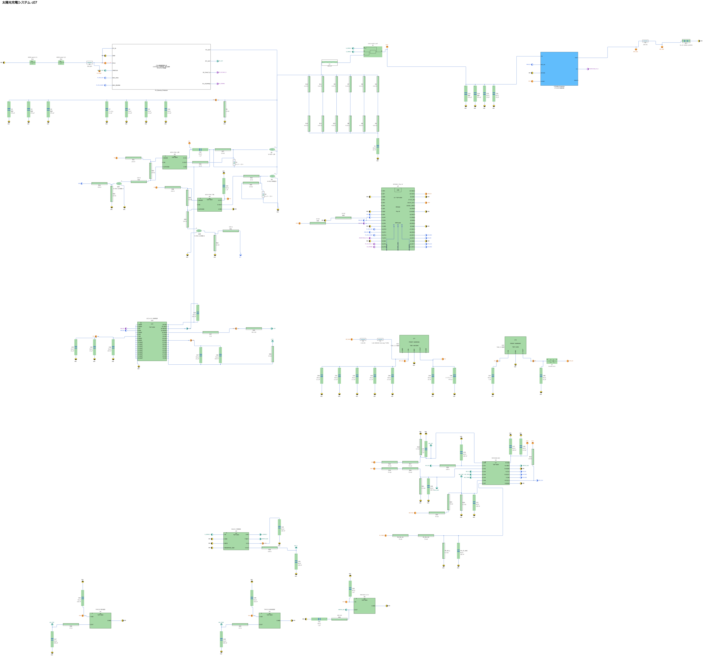

# c07 MATLAB回路図

エリア枠と図の周囲の長い説明文を除いた回路図です。部品名・値・端子名と、各ブロックのプロパティ内の説明は残しています。

[拡大できる全体図（SVG）](c07_circuit.svg) ／ [MATLABモデル](models/solar_pv_protected_c07_circuit.slx)

## MATLABで開く

1. このフォルダを依存ファイルごとダウンロードします（リポジトリの **Code → Download ZIP** でも取得できます）。
2. MATLABでこのフォルダを現在のフォルダにし、`OPEN_C07` を実行します。
3. 保護回路の内部を見るには、`PV_Reverse_Protection` または `LTC4364_Protection` を開きます。部品の説明はブロックプロパティで確認できます。

確認環境は Windows版 MATLAB R2026b、Simulink、Simscape、Simscape Electrical、Simscape Battery です。同梱の自作ライブラリは起動スクリプトが読み込みます。MathWorks製品のライブラリ本体は同梱していません。同名の別モデルを開いている場合は、作業を保存してそのモデルを閉じてから実行してください。

このファイルは端子と接続を確認する**回路図用モデル**です。ICの編集用記号を含み、そのまま全体の動作シミュレーションを行うモデルではありません。今回確認したのは、説明表示の整理前後で部品・配線・設定が維持されていることと、保存した図面を開けることです。

`MANIFEST.json` に同梱ファイルのSHA-256を記録しています。`OPEN_C07` は配布時のファイルとの一致を確認するため、編集後はモデルファイルを直接開いてください。
